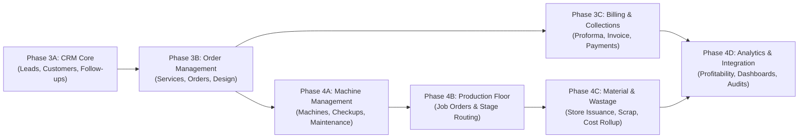

# Implementation Plan: CRM, Order & Production Operations
**GT ERP Platform (Phases 3 & 4)**

This document provides the complete roadmap for implementing the database models, backend business logic, and user interfaces defined in [db_schema.md](./db_schema.md).

---

## Phase 3A: CRM Core (Leads, Customers & Follow-ups)
> **Goal**: Establish the customer acquisition foundation, customer relationship database, and interaction scheduling.

### Tasks
1. **Database Models & Schemas**:
   - Create `backend/models/Lead.js` (with pipeline stages: `new` $\to$ `contacted` $\to$ `qualified` $\to$ `proposal_sent` $\to$ `converted` $\to$ `lost`).
   - Create `backend/models/Customer.js` (including TIN/VAT, contact persons array, billing/shipping addresses, and credit limits).
   - Create `backend/models/Followup.js` (polymorphic relation to `Lead` or `Customer`, priority, reminder dates, assigned sales rep).
   - Register models in `backend/models/index.js`.
2. **Backend Controllers & Routes**:
   - `backend/controllers/leadController.js` & `backend/routes/leadRoutes.js`: CRUD, status pipeline updates, discussion logs, and conversion action (`POST /api/leads/:id/convert`).
   - `backend/controllers/customerController.js` & `backend/routes/customerRoutes.js`: CRUD, credit terms configuration, search & filter by category, order/invoice history lookup.
   - `backend/controllers/followupController.js` & `backend/routes/followupRoutes.js`: Scheduling, calendar agenda view, completion logging, overdue notifications via `backend/utils/notificationService.js`.
3. **Frontend UI Components**:
   - Lead Pipeline Kanban board and Lead Detail Drawer with discussion logs.
   - Customer Master Directory with business profile, tax information, and credit limit badges.
   - Follow-up Calendar / Task list with automatic reminder badges.

### Phase 3A Deliverables & Outcomes
- Fully searchable CRM directory with role-based access for sales reps and managers.
- One-click lead conversion into formal Customers, preserving all historical discussion logs.
- Enforced customer credit limits and tax identification numbers for downstream billing.

---

## Phase 3B: Printing Services & Order Management
> **Goal**: Model printing press service catalogs, dynamic price estimation, sales order creation, and pre-press design proofing.

### Tasks
1. **Database Models & Schemas**:
   - Create `backend/models/Service.js` (service master catalog, pricing models, standard specs, and routing workflow templates).
   - Create `backend/models/Order.js` (multi-item sales orders, detailed printing specs, estimated cost rollup, delivery tracking).
   - Create `backend/models/Design.js` (artwork specifications, versioned file proofs, client approval/revision workflow).
2. **Business Logic & Cost Estimation**:
   - Implement `backend/utils/pricingCalculator.js`: Dynamic calculation of estimated raw material requirements (paper sheets, ink), machine run hours, and labor based on order specs.
   - Implement `backend/controllers/orderController.js`: Order state machine (`draft` $\to$ `proforma_issued` $\to$ `confirmed` $\to$ `design_approved` $\to$ `in_production` $\to$ `completed`).
   - Implement `backend/controllers/designController.js`: File proof upload integration via Cloudinary/multer, version numbering, and client sign-off endpoints.
3. **Frontend UI Components**:
   - Service Catalog Management with configurable workflow steps.
   - Sales Order Creation Wizard with dynamic spec selectors (Paper GSM, dimensions, colors, binding).
   - Interactive Pre-press Proofing portal: view file thumbnails, download print-ready PDFs, submit revision comments, or approve proofs.

### Phase 3B Deliverables & Outcomes
- Standardized printing service templates with bill-of-materials and routing sequences.
- Structured sales orders with automated cost estimation and deadline tracking.
- Closed-loop design approval preventing unapproved artwork from reaching the production press.

---

## Phase 3C: Proformas, Invoices & Payment Collections
> **Goal**: Streamline commercial documentation, legal tax invoicing (Ethiopian VAT), and payment collection against credit limits.

### Tasks
1. **Database Models & Schemas**:
   - Create `backend/models/Proforma.js` (formal quotation document with validity window and line items).
   - Create `backend/models/Invoice.js` (tax invoice, unique sequence, VAT 15%, withholding tax, balance tracking).
   - Create `backend/models/CustomerPayment.js` (payment receipts, bank details, method, check attachment).
2. **Backend Controllers & Financial Synchronization**:
   - `backend/controllers/proformaController.js`: Conversion from Order/Quotation, PDF generation endpoint.
   - `backend/controllers/invoiceController.js`: Generate official invoice from confirmed order, track paid amount vs remaining balance.
   - `backend/controllers/customerPaymentController.js`: Transactionally record payment, increment `Invoice.paidAmount`, decrement `Customer.creditTerms.currentBalance`, and update `Invoice.paymentStatus`.
3. **PDF Generation & Exports**:
   - Implement PDF generation templates (Proforma Invoice, Tax Invoice, Payment Receipt) using standard server-side rendering (e.g. PDFKit).
4. **Frontend UI Components**:
   - Proforma & Invoice detail views with print/export actions.
   - Payment collection modal with receipt attachment upload.
   - Accounts Receivable Aging & Customer Debt summary tables.

### Phase 3C Deliverables & Outcomes
- Compliant tax invoices with automated VAT and withholding tax calculations.
- Live tracking of customer credit balances and automated payment status transitions (`unpaid` $\to$ `partially_paid` $\to$ `paid`).
- Instant PDF downloads for customer quotations, invoices, and payment vouchers.

---

## Phase 4A: Machine Registry & Maintenance Operations
> **Goal**: Register plant equipment, enforce preventive maintenance checklists, and manage machine breakdowns and downtime.

### Tasks
1. **Database Models & Schemas**:
   - Create `backend/models/Machine.js` (code, specs, category, hourly rate, operator assignment, checklist definitions).
   - Create `backend/models/MachineCheckup.js` (daily/weekly/monthly checkup logs with pass/fail item status).
   - Create `backend/models/MachineMaintenance.js` (breakdown tickets, technician assignment, spare parts used, downtime hours).
2. **Backend Logic & Store Integration**:
   - `backend/controllers/machineController.js`: Machine status state machine (`available`, `running`, `maintenance`, `breakdown`).
   - `backend/controllers/machineCheckupController.js`: Checkup submission; automatically flag machines that fail critical checks.
   - `backend/controllers/machineMaintenanceController.js`: Ticket creation, tracking repair progress, recording spare parts drawn from `InventoryItem`, and logging maintenance expenses.
3. **Frontend UI Components**:
   - Machine Plant Overview with status indicators (green = available, blue = running, amber = maintenance, red = breakdown).
   - Mobile-friendly Operator Daily Checkup form.
   - Maintenance Ticket dashboard with downtime tracking and spare parts usage logs.

### Phase 4A Deliverables & Outcomes
- Centralized machine asset registry with operating hourly cost rates for accurate job costing.
- Standardized digital maintenance checkup workflows.
- Real-time visibility into machine downtime, repair history, and maintenance expenses.

---

## Phase 4B: Production Floor & Stage Routing
> **Goal**: Convert confirmed sales orders into Job Orders (Work Orders), assign operators, and track multi-stage production execution.

### Tasks
1. **Database Models & Schemas**:
   - Create `backend/models/ProductionJob.js` (Job order number, customer/order refs, dynamic sequential stages array, run hours, QC sign-off).
2. **Backend Controllers & Stage Engine**:
   - Auto-generate `ProductionJob` when an `Order` reaches `design_approved` status, instantiating stages from `Service.workflowTemplate`.
   - `backend/controllers/productionJobController.js`: Endpoints to start/pause/complete stages (`POST /api/production-jobs/:id/stages/:seq/start`, `complete`).
   - Track machine hours run and operator labor hours per stage.
   - Quality inspection sign-off checkpoint before releasing to packaging/delivery.
3. **Frontend UI Components**:
   - Production Floor Kanban / Gantt timeline tracking jobs across plant stages (Pre-press $\to$ Press $\to$ Lamination $\to$ Finishing $\to$ QC).
   - Operator Job Station Terminal: quick-action interface for machine operators to start jobs, record completed counts, and sign off stages.

### Phase 4B Deliverables & Outcomes
- Live digital dispatching of print jobs to machine stations.
- Full traceability of which operator and machine executed each stage of an order.
- Elimination of floor bottlenecks through real-time stage progress monitoring.

---

## Phase 4C: Material Consumption, Wastage & Cost Rollup
> **Goal**: Connect production execution directly to the Store module, capture raw material waste, and compute actual order profitability.

### Tasks
1. **Store Module Integration**:
   - Connect `ProductionJob` with existing `StockRequest`: automatically generate material requests for paper, ink, and consumables.
   - Record actual consumed vs. returned unused quantities when a job finishes.
2. **Database Models & Schemas**:
   - Create `backend/models/ProductionWastage.js` (categorized waste items, unit costs, root causes, responsible stage/machine, and approval status).
3. **Backend Controllers & Cost Rollup Engine**:
   - `backend/controllers/productionWastageController.js`: Register spoilage, submit for manager approval, and compute total financial waste loss.
   - Cost Rollup Engine: Upon completion of a `ProductionJob`, aggregate:
     $$\text{Actual Cost} = \text{Materials} + \text{Machine Hours} \times \text{Rate} + \text{Labor} + \text{Wastage} + \text{Finishing}$$
   - Write actual cost and calculated profit margin into `Order.actualCostSummary`.
4. **Frontend UI Components**:
   - Raw Material Requisition & Return interface on the Job Order view.
   - Production Wastage entry form with reason categorization (e.g. setup waste, machine jam, plate defect).
   - Job Cost Breakdown Modal: side-by-side visual comparison of Estimated Cost vs. Actual Cost.

### Phase 4C Deliverables & Outcomes
- Closed-loop material deduction in the Store inventory without discrepancies.
- Formal logging and manager approval of production scrap and defects.
- Automated order profitability analysis (Estimated vs. Actual margins).

---

## Phase 4D: Analytics, Executive Dashboards & Navigation Activation
> **Goal**: Activate user-facing modules in navigation, implement executive KPI dashboards, and finalize multi-level approval history.

### Tasks
1. **Approval Workflow Integration**:
   - Update `backend/models/ApprovalHistory.js` to support references for `'sales order'`, `'proforma'`, `'production wastage'`, and `'machine maintenance'`.
2. **Dashboard Analytics Endpoints**:
   - CRM Dashboard: Lead conversion rates, pipeline value, sales rep performance, active orders.
   - Production Dashboard: Machine utilization rate, job turnaround time, daily output volume, scrap percentage.
3. **Navigation & Permissions Activation**:
   - Update `webfrontend/src/config/modules.js` changing `crm` and `production` module statuses from `'upcoming'` to `'active'`.
   - Add routes and navigation sub-links in the React frontend application.

### Phase 4D Deliverables & Outcomes
- Live CRM and Production executive dashboards.
- Seamless end-to-end integration across Sales $\to$ Design $\to$ Production $\to$ Store $\to$ Finance.
- Fully active navigation matrix with strict role-based access control.

---

## Phase Timeline & Verification Checklist

| Phase | Milestone | Key Verification Metric | Status |
| :--- | :--- | :--- | :--- |
| **Phase 3A** | CRM Core | Create lead $\to$ log discussions $\to$ convert to Customer $\to$ schedule follow-up. | ✅ Completed |
| **Phase 3B** | Order & Design | Define Service $\to$ create Order with specs $\to$ upload artwork $\to$ approve proof. | ✅ Completed |
| **Phase 3C** | Invoicing & Payments | Issue Proforma $\to$ convert to Tax Invoice $\to$ collect payment $\to$ verify customer balance updates. | ✅ Completed |
| **Phase 4A** | Machines & Maintenance | Register machine $\to$ submit daily checkup $\to$ create breakdown ticket $\to$ resolve with spare part deduction. | ✅ Completed |
| **Phase 4B** | Floor Job Routing | Generate Job Order $\to$ step through all production stages $\to$ QC inspection sign-off. | ✅ Completed |
| **Phase 4C** | Material & Wastage | Issue stock from Store $\to$ record scrap with root cause $\to$ verify automated Estimated vs Actual cost rollup. | ✅ Completed |
| **Phase 4D** | Analytics & Launch | Dashboards display live metrics $\to$ navigation is unlocked $\to$ end-to-end audit logs verified. | ✅ Completed |

